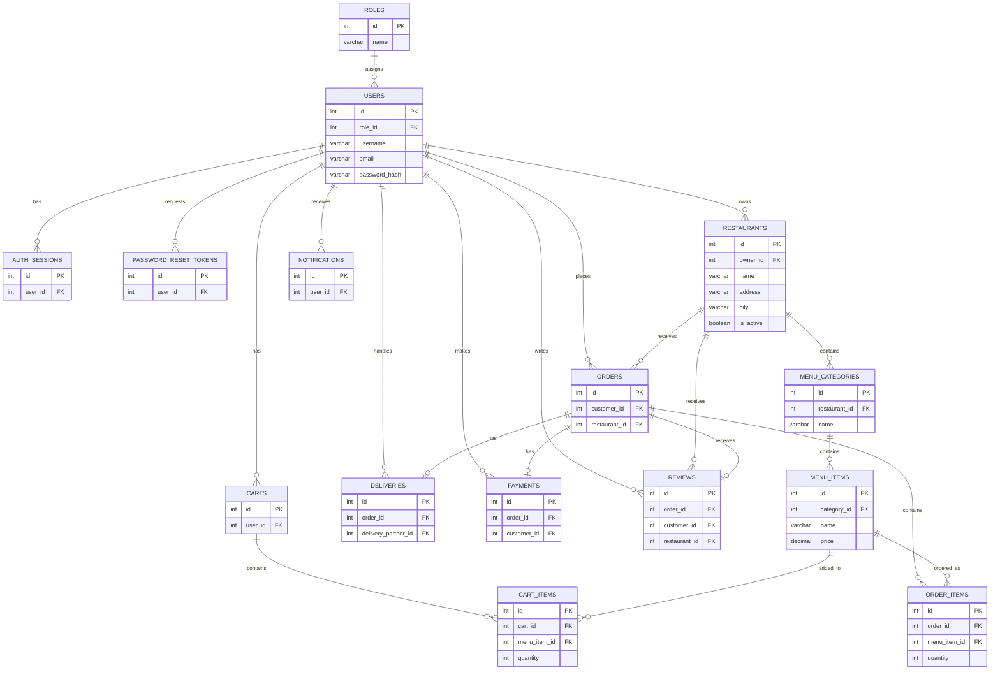

# FoodieExpress – Entity Relationship Diagram

The following ER diagram represents the main database tables and their relationships.

**Note:** This is a high-level relationship diagram. Confirm the exact column names and cardinalities against your SQL schema before treating it as the final database specification.